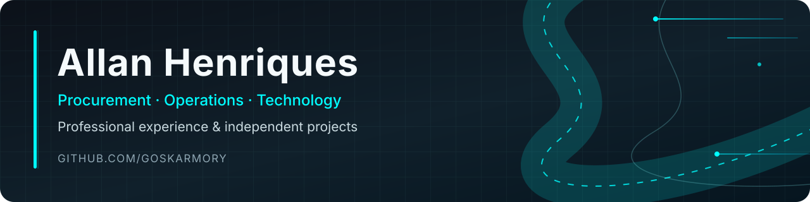

  

  <a href="https://www.linkedin.com/in/avhenriques/">LinkedIn</a> ·
  <a href="https://sk4rstudios.com/">SK4R Studios</a> ·
  <a href="https://orcid.org/0009-0008-9709-7334">ORCID</a>

## English

I work with **procurement and operations**, including supplier management, negotiation, contract processes, performance indicators, and process organization. Alongside my professional work, I explore software development through independent projects involving simulation and artificial intelligence.

### Professional background

- **Procurement and supplier management:** supplier relationships, sourcing, comparative analysis, and negotiation.
- **Contracts and operations:** contract follow-up, administrative processes, and cross-functional coordination.
- **Processes and indicators:** workflow organization, monitoring of results, and opportunities for improvement.

### Independent projects

**SK4R Studios** — [sk4rstudios.com](https://sk4rstudios.com/)  
My **personal, one-person initiative** for exploring game development. It is an independent project in progress, not a staffed game studio.

**Motorsport Founders** — *In development*  
A motorsport team-management game planned for the browser, focused on decisions made outside the cockpit. Design and technical validation are still in progress; the game has not been released.

**2D Autonomous Driving Simulator** — *Experimental project*  
An environment using Python and FastAPI to investigate how virtual driving agents can navigate tracks with sensors and neuroevolution. This is a technical experiment, separate from a finished game.

### Technology and interests

`Python` · `FastAPI` · `Git` · `GitHub` · `Linux` · `Raspberry Pi`  
Interests: simulation, AI, game development, automation, and technical documentation.

---

## Português

Atuo em **Compras e Operações**, com experiência em gestão de fornecedores, negociações, contratos, indicadores e organização de processos. Paralelamente, estudo e desenvolvo projetos técnicos próprios relacionados à simulação e à inteligência artificial.

### Experiência profissional

- **Compras e fornecedores:** relacionamento com fornecedores, cotações, análises comparativas e negociações.
- **Contratos e operações:** acompanhamento contratual, rotinas administrativas e articulação entre áreas.
- **Processos e indicadores:** organização de fluxos, acompanhamento de resultados e identificação de melhorias.

### Projetos independentes

**SK4R Studios** — [sk4rstudios.com](https://sk4rstudios.com/)  
Minha **iniciativa pessoal e individual** voltada ao desenvolvimento de jogos. É um projeto independente em construção, sem equipe contratada ou estrutura de estúdio de grande porte.

**Motorsport Founders** — *Em desenvolvimento*  
Jogo de gerenciamento de equipes automobilísticas planejado inicialmente para navegadores, com foco nas decisões tomadas fora da pista. O planejamento e as validações técnicas continuam; o jogo ainda não foi lançado.

**Simulador 2D de Direção Autônoma** — *Projeto experimental*  
Ambiente em Python e FastAPI para explorar agentes virtuais que percorrem pistas a partir de sensores e neuroevolução. É um experimento técnico separado de um produto finalizado.

### Tecnologias e interesses

`Python` · `FastAPI` · `Git` · `GitHub` · `Linux` · `Raspberry Pi`  
Interesses: simulação, IA, desenvolvimento de jogos, automação e documentação técnica.

---

### Links e perfis · Links and profiles

[GitHub](https://github.com/goskarmory) · [LinkedIn](https://www.linkedin.com/in/avhenriques/) · [SK4R Studios](https://sk4rstudios.com/) · [ORCID](https://orcid.org/0009-0008-9709-7334) · [Instagram](https://www.instagram.com/avhenriques/) · [Facebook](https://www.facebook.com/avhenriques/)

Public project repositories will be linked as they become available. · Os repositórios públicos dos projetos serão vinculados quando estiverem disponíveis.
